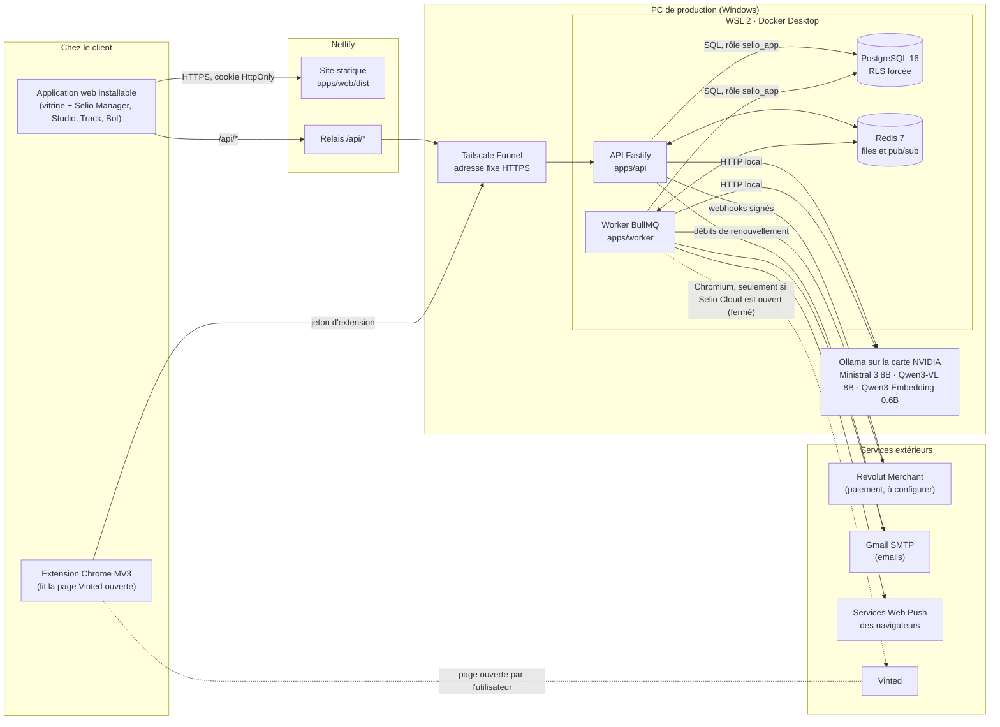

# Selio — guide technique : comment Selio a été développé

_Version du 20 novembre 2026. Selio est conçu et développé par **Ibrahim** (cofondateur : produit, technique, IA), avec **Elias** (cofondateur : direction, marketing, croissance)._

Ce guide raconte Selio de l'intérieur : à quoi il sert, comment il est construit, pourquoi chaque choix a été fait, comment il est protégé, testé et mis en ligne, et comment il est né, semaine après semaine. Il renvoie aux documents détaillés pour chaque sujet (sommaire complet : [README.md](README.md)). Les procédures d'activation pas à pas sont dans [TUTORIELS.md](TUTORIELS.md).

Règle suivie partout dans le code et dans la documentation : **dire ce qui est vrai aujourd'hui**. Ce qui n'a pas été mesuré est écrit « à mesurer » ; ce qui n'a jamais tourné contre Vinted est écrit comme tel ; ce qui attend l'avis de l'avocat reste fermé par défaut.

---

## 1. Vision et organisation

Selio est un écosystème d'outils pour les revendeurs Vinted : gérer son stock et ses annonces, répondre et négocier, analyser le marché, trouver et acheter des articles, au même endroit, avec une IA qui tourne sur notre propre machine.

### 1.1 Les cinq filiales

| Ordre | Filiale | Rôle | Où dans l'application | Documentation |
|---|---|---|---|---|
| 1 | **Selio Manager** | Gestion complète et automatisation de l'activité : stock, dressing, remise en ligne, messages, négociation par IA, relances, commandes, marges, multi-comptes, journal d'activité | `/app` | [ARCHITECTURE.md](ARCHITECTURE.md), [NEGOCIATION.md](NEGOCIATION.md), [MIGRATION.md](MIGRATION.md) |
| 2 | **Selio Studio** | Création d'annonces par l'IA : tri des photos, étiquette et mesures lues avec leur provenance, annonce rédigée, prix conseillé | `/studio`, `/app/studio` | [STUDIO.md](STUDIO.md), [PRIX.md](PRIX.md) |
| 3 | **Selio Track** | Analyse du marché : filtres suivis toutes les 2 h, tendances, niches notées sur 100, recherche par photo, alertes de tendance (statistiques seulement) | `/track` | [TRACK.md](TRACK.md), [PRIX.md](PRIX.md) |
| 4 | **Selio Bot** | Recherche et achat : recherches surveillées, bonnes affaires notées sur 100, revente estimée, achat rapide en 1 clic, achat automatique (fermé par défaut) | `/bot`, `/app/radar`, `/app/purchase` | [BOT.md](BOT.md), [RADAR.md](RADAR.md) |
| 5 | **Selio Compte** | Services autour des comptes Vinted et accompagnement, payés une fois ou sur devis | `/comptes` | [VITRINE.md](VITRINE.md) |

Deux **fonctionnalités de Selio Manager** (et non des filiales) :

- **Selio Cloud** : le moteur qui agit sur un compte Vinted depuis notre machine quand l'ordinateur du client est éteint (répondre, relancer). Construit et testé, **fermé par défaut** ([CLOUD.md](CLOUD.md)).
- **Selio Agent** : la délégation à une équipe ou à des prestataires (cinq rôles, invitations, journal d'audit).

Et un espace interne : **Selio Admin** (`/admin`), réservé à l'équipe (Ibrahim en rôle technique, Elias en rôle business) : comptes, qualification, accès offert, offres commerciales, Track, santé, supervision.

L'ancien nom « Selio Radar » a disparu de l'interface : ses écrans sont ceux de Selio Bot (les adresses `/app/radar` et les noms techniques `radar_*` sont gardés dans le code).

### 1.2 Deux modes, clairement séparés

| Mode | Ce qu'il montre | Ce qu'il ne montre pas |
|---|---|---|
| **Démonstration** (`/demo`, développement local) | Le parcours complet et les règles métier, avec des données fictives gardées dans le navigateur et des simulateurs déterministes | Toute intégration réelle |
| **Connecté** (production) | Vrais comptes, base PostgreSQL isolée par organisation, IA locale, paiement (simulé tant que Revolut n'est pas configuré) | Les connecteurs Vinted (expérimentaux) |

En production, la vitrine ne propose plus la démonstration : `/demo` renvoie vers l'inscription, et l'application affiche « En cours d'activation » plutôt que des chiffres de simulateur (`GET /api/capabilities`).

---

## 2. Architecture



Points clés :

- **Le navigateur n'appelle jamais l'IA ni la base** : seuls l'API et le worker parlent à Ollama, à PostgreSQL et à Redis. Ollama, PostgreSQL et Redis ne sont jamais ouverts sur Internet ; Tailscale Funnel n'expose que le port 8787 de l'API.
- **Même adresse pour le site et l'API** : Netlify relaie `https://<site>/api/*` vers l'adresse fixe Tailscale du PC. Les cookies de session restent donc « même site ».
- **Le worker fait tout ce qui est planifié** : automatisations, relances de paiement, Track, alertes, supervision, sauvegarde des modèles de prix, rétention. Chromium (Selio Cloud, lecture en direct de Track et de Selio Bot) n'est lancé que par le worker, et seulement si l'interrupteur est ouvert.
- **L'extension** n'agit que sur la page Vinted que l'utilisateur a ouverte ; elle insère un texte, elle n'envoie jamais à sa place.

Le détail des flux (message, commande, automatisation, Cloud, Track, Bot, Studio, paiement) est dans [ARCHITECTURE.md](ARCHITECTURE.md).

### 2.1 Le monorepo

| Dossier | Rôle |
|---|---|
| `apps/web` | Vitrine + application (React 19, Vite 7, react-router 7, TanStack Query, Tailwind v4, PWA). Une interface `DataClient` implémentée deux fois : `DemoClient` (navigateur) et `ApiClient` (serveur) |
| `apps/api` | API Fastify 5 : sessions, rôles, RLS, jetons d'extension, webhooks Revolut, relais WebSocket de la fenêtre de connexion du Cloud |
| `apps/worker` | Planificateur BullMQ : automatisations, file des tâches, échéances d'abonnement, Track, Bot, Cloud, alertes, supervision, entraînement du modèle de prix, rétention |
| `apps/extension` | Extension Chrome MV3 : popup, options, service worker (seul détenteur du jeton), content script isolé sur Vinted |
| `packages/contracts` | Schémas Zod partagés, libellés, offres et quotas |
| `packages/domain` | Règles métier pures : argent en centimes, marge, prix plancher, négociation, note des affaires, permissions, aide (FAQ et tutoriels) |
| `packages/core` | Services serveur partagés par l'API et le worker |
| `packages/db` | Pool PostgreSQL, transactions par organisation, migrations SQL, RLS, coffre AES-GCM, dépôts |
| `packages/ai` | `AIProvider`, simulateur, Ollama, disjoncteur, file, consignes, validation des sorties |
| `packages/cloud` | Socle navigateur de Selio Cloud et lecteur de pages (Playwright, bac à sable obligatoire) |
| `packages/pricing` | Modèle de prix maison (gradient boosting quantile en TypeScript, sur le processeur) |
| `packages/storage` | Stockage S3 compatible (signature SigV4 maison, URLs signées) |
| `packages/email` | Emails transactionnels (`noop` ou SMTP) |
| `packages/connectors` | Simulateur, connecteur Vinted expérimental (adaptateurs versionnés), client Revolut |
| `packages/ui` | Composants et jetons de la charte violet/or |
| `packages/demo-data` | Jeu de données de démonstration, tarifs indicatifs (`PRICING`) |

---

## 3. Choix techniques, et pourquoi

| Choix | Pourquoi | Ce qu'on a écarté |
|---|---|---|
| **Monorepo pnpm, TypeScript partout** | Un seul langage du navigateur à la base ; les schémas Zod de `contracts` et les règles de `domain` sont partagés par le web, l'API, le worker et l'extension : la démonstration applique exactement les mêmes règles que le serveur | Dépôts séparés (versions qui divergent), Python pour le modèle de prix (D39) |
| **Fastify** | Rapide, validation et sérialisation par schéma, plugins simples (CORS, Helmet, WebSocket), corps brut accessible pour vérifier la signature des webhooks | Express (moins strict), un framework « tout-en-un » |
| **PostgreSQL 16 + RLS forcée** | Chaque requête métier pose `set local app.org_id` ; PostgreSQL refuse toute ligne d'une autre organisation, même si le code oublie un filtre. Migrations SQL lisibles, testables sur une base jetable | SDK Supabase et Supabase Auth (D05 : dépendance inutile ; la base reste compatible si on veut l'héberger chez eux) |
| **BullMQ (Redis) + table `jobs`** | BullMQ déclenche les passages planifiés ; la table `jobs` garde l'état observable (idempotence, tentatives, résultat) (D09) ; Redis sert aussi de relais pub/sub pour la fenêtre de connexion du Cloud | Cron système, file maison |
| **Ollama sur notre machine, trois modèles** | Les photos et les messages des clients ne partent chez aucun fournisseur d'IA ; coût fixe ; un modèle par tâche (D17) | API d'IA payantes (données qui sortent, coût à la requête) |
| **Application web installable (PWA)** | Une seule application pour l'ordinateur, la tablette et le téléphone, installable sur l'écran d'accueil, notifications Web Push sans service payant | Applications natives iOS et Android (deux codes de plus, publication en magasin) |
| **Extension Chrome MV3** | Vinted n'a pas d'API publique pour les vendeurs : l'extension lit la page que l'utilisateur a ouverte, avec sa session, sans jamais demander son mot de passe (D08) | Faux OAuth, robot avec mot de passe |
| **Tailscale Funnel** | Adresse HTTPS fixe et gratuite pour l'API du PC, qui ne change pas au redémarrage (fin des 502 du tunnel rapide), sans ouvrir de port sur la box | Tunnel rapide Cloudflare (adresse qui change), VPS loué |
| **Netlify** | Site statique, CDN, en-têtes de sécurité (CSP stricte) et relais `/api/*` vers le PC : site et API à la même adresse | Héberger le site sur le PC (plus fragile, pas de CDN) |
| **Bundles esbuild pour l'API et le worker** (D15) | Images Docker légères, démarrage rapide | Transpilation à l'exécution |
| **Paiement par Revolut Merchant API, sans SDK** (D24) | Carte enregistrée « pour le marchand », débits de renouvellement depuis le worker, webhooks signés ; une interface `PaymentProvider` permet un fournisseur de secours | Stripe (retiré le 29 octobre 2026) |

Le journal complet des décisions (D01 à D61) est dans [DECISIONS.md](DECISIONS.md).

---

## 4. Modèle de données

### 4.1 Principes

- Toute table métier porte `org_id` ; la politique RLS `org_isolation` est **forcée** pour le rôle applicatif `selio_app` (non superutilisateur, `NOBYPASSRLS`). L'API et le worker n'utilisent jamais le rôle propriétaire `selio`, réservé aux migrations et à la sauvegarde.
- Montants en **centimes entiers** ; aucune virgule flottante.
- Idempotence partout où un doublon coûterait : commandes (`dedupe_key`), tâches (`jobs.dedupe_key`), webhooks (`payment_events`), factures (`order_id` unique, compteur transactionnel `SEL-AAAA-000001`).
- Les tables partagées sans organisation (références de prix, références de tailles, instantanés de Track) ne contiennent **aucune donnée personnelle** ; certaines ne s'atteignent que par des fonctions `SECURITY DEFINER`.
- Secrets de connexion et sessions Cloud chiffrés en AES-256-GCM avec `SECRETS_ENCRYPTION_KEY`, gardée hors de la base.

### 4.2 Tables principales

| Domaine | Tables |
|---|---|
| Comptes et équipe | `users`, `sessions`, `organizations`, `memberships`, `invites`, `password_resets`, `extension_tokens`, `audit_logs`, `rate_limits` |
| Vente (Selio Manager) | `marketplace_connections`, `inventory_items`, `inventory_events`, `customers`, `conversations`, `messages`, `orders`, `shipments`, `automation_rules`, `automation_state`, `jobs`, `negotiation_limits`, `migration_mappings` |
| IA et usage | `ai_requests`, `usage_events`, `embeddings_cache` |
| Abonnement | `subscriptions`, `payment_orders`, `payment_events`, `invoices`, `invoice_counters`, `referral_codes`, `referrals`, `subscription_credits`, `commercial_offers`, `offer_redemptions` |
| Selio Cloud | `cloud_consents`, `cloud_accounts`, `cloud_actions`, `cloud_login_sessions`, `cloud_runtime` |
| Selio Bot | `radar_searches`, `opportunities`, `purchase_requests`, `radar_reads`, `radar_alerts`, `push_subscriptions` |
| Selio Track et prix | `track_filters`, `track_filter_reads`, `track_runtime`, `track_snapshots`, `track_scans`, `track_photo_searches`, `track_alert_events`, `track_read_log`, `price_references`, `price_models` |
| Selio Studio | `studio_preps`, `size_references`, `worn_photo_jobs` |
| Selio Compte et supervision | `account_checklist_progress`, `supervision_targets`, `supervision_checks` |

### 4.3 Migrations (`packages/db/migrations`)

Toutes additives et idempotentes, appliquées dans l'ordre des noms par `pnpm db:migrate` (table `schema_migrations`, verrou consultatif) ou par le service `migrate` de Docker Compose.

| Migration | Contenu |
|---|---|
| `0001_schema.sql` | Schéma de départ : utilisateurs, organisations, stock, conversations, commandes, automatisations, tâches, recherches et affaires, abonnements, audit |
| `0002_rls.sql` | Isolation par organisation (RLS forcée), rôle `selio_app` |
| `0003_dressing_studio.sql` | Dressing intelligent, republications, générateur d'annonces, achat automatique |
| `0004_connection_usage.sql` | Comptes Vinted catégorisés (vente, achat, perso) |
| `0005_subscription_card_cancel.sql` | Carte enregistrée dès l'essai, résiliation en fin de période |
| `0006_admin_usage.sql` | Vue administrateur de l'utilisation par client |
| `0007_tokens_email.sql` | Jetons à usage unique envoyés par email (mot de passe oublié, invitations) |
| `0008_quotas_backfill_admin_ai.sql` | Rattrapage des quotas par filiale des anciens abonnements |
| `0009_revolut.sql` | Paiement Revolut : commandes, factures, identifiants Revolut |
| `0010_billing_hardening.sql` | Compteur de factures transactionnel, réservation des webhooks |
| `0011_cloud.sql` | Selio Cloud : accord, comptes, session chiffrée, journal, coupe-circuit, `app_cloud_after_restore()` |
| `0012_radar.sql` | Lecture en direct, achat automatique, mesures, notifications Web Push, cache d'embeddings |
| `0013_track_pricing.sql` | Selio Track et base de références de prix, modèles de prix |
| `0014_studio.sql` | Studio : références de tailles, préparations, photos portées |
| `0015_negociation_migration.sql` | Limites de Vinted mesurées, migration depuis un autre outil |
| `0016_roles_referral.sql` | Cinq rôles d'équipe, parrainage |
| `0016_supervision_vinted_pro.sql` | Supervision des services, fournisseur `vinted_pro` |
| `0017_selio_comptes.sql` | Checklist de mise en place d'une boutique (Selio Compte) |
| `0018_referral_refused_supervision_delivery.sql` | Parrainage « refusé », canaux délivrés de la supervision |
| `0019_operateurs_qualification.sql` | Selio Admin : qualification des comptes, accès offert |
| `0020_offres_commerciales.sql` | Offres commerciales, codes promo, bandeau |
| `0021_track_suivi.sql` | Alertes de tendance de Track, pause manuelle, journal des lectures |
| `0022_manager_journal.sql` | Journal d'activité (index) et raccourcis personnalisés |
| `0023_paiement_simule.sql` | Paiement simulé en attendant Revolut (offre retenue, « en attente du paiement ») |

Les deux fichiers 0016 ne sont pas renommés : une base qui les a déjà appliqués les rejouerait.

---

## 5. Sécurité

Détail complet : [SECURITY.md](SECURITY.md).

- **Secrets** : variables d'environnement validées au démarrage (Zod) dans `deploy/.env` sur le PC (`chmod 600`), jamais dans Git, jamais dans Netlify (seules les variables `VITE_` publiques y vont). Copie chiffrée à part ([SAUVEGARDE.md](SAUVEGARDE.md) §1.1). Aucun secret ne passe par une conversation : les clés externes sont collées par Ibrahim directement dans le fichier.
- **Isolation** : RLS forcée par organisation, plus les contrôles applicatifs `can(role, action)`.
- **Cinq rôles d'équipe** : titulaire, administrateur, exécuteur (sans les finances, masquées par le serveur à toute profondeur), contributeur photos (liste blanche de routes), lecture seule (le comptable).
- **Opérateurs Selio** : `OPERATOR_EMAILS` donne le rôle **technique** (tout), `OPERATOR_BUSINESS_EMAILS` le rôle **business** (croissance, comptes, offres, usage de Track), relus à chaque requête : un compte existant devient opérateur après la relance de l'API, sans requête SQL.
- **Sessions** : mot de passe haché (scrypt), cookie `HttpOnly`, `SameSite=Lax`, `Secure` imposé en production (`COOKIE_SECURE=true`, sinon refus de démarrer), expiration glissante 30 jours ; jetons d'email (32 octets, empreinte SHA-256 seule, usage unique).
- **En-têtes** : CSP stricte sur Netlify (`netlify.toml` et `deploy/netlify/_headers`, identiques ; seuls les hôtes du formulaire Revolut sont autorisés en plus), HSTS, Helmet côté API, CORS limité aux origines configurées.
- **Entrées non fiables** : messages d'acheteurs et pages lues nettoyés, balisés, jamais interprétés comme des consignes ; sortie de l'IA validée par schéma puis par politique.
- **Interrupteurs fermés par défaut** (garde-fous en variables d'environnement) :

| Interrupteur | Défaut | Ce qu'il ouvre | Condition d'ouverture |
|---|---|---|---|
| `CLOUD_ENABLED` | `false` | Selio Cloud (et toute lecture en direct) | Avis de l'avocat favorable (26 novembre 2026) ; Chromium avec bac à sable ; ouverture progressive |
| `TRACK_LIVE_ENABLED` | `false` | Lecture des pages publiques par Track | Avis de l'avocat favorable (26 novembre 2026) ; ouverture progressive ([TRACK.md](TRACK.md) §7) |
| `TRACK_SELLER_ANALYSIS_ENABLED` | `false` | Analyse d'un vendeur concurrent (non construite) | RGPD |
| `RADAR_AUTO_ENABLED` (+ `RADAR_AUTO_ORG_IDS`) | `false` | Achat automatique de Selio Bot | Décision d'Ibrahim, comptes de l'équipe seulement |
| `RADAR_REAL_PURCHASE` | `false` | Clic sur « Payer » | Décision écrite d'Ibrahim, le temps d'un test |
| `REVOLUT_LIVE_ALLOWED` | `false` | Argent réel (`REVOLUT_MODE=live`) | Parcours validé en bac à sable |
| `REFERRAL_ENABLED` | `false` | Parrainage | Décision d'Ibrahim, conditions relues |
| `WORN_OVERAGE_ENABLED` | `false` | Photos portées au-delà du quota | Prix fixé par Ibrahim |
| `ALLOW_AI_FALLBACK` | `false` | Texte de secours présenté à la place de l'IA | Jamais en production |

---

## 6. IA

Trois modèles, tous servis par **Ollama** sur la carte NVIDIA du PC, appelés seulement par l'API et le worker ([OLLAMA-SETUP.md](OLLAMA-SETUP.md)) :

| Modèle | Variable | Rôle |
|---|---|---|
| **Ministral 3 8B** (`ministral-3:8b`), « mon IA perso » | `OLLAMA_MODEL` | Texte : réponses aux acheteurs, annonces, aide, explication des prix, textes de Selio Compte |
| **Qwen3-VL 8B** (`qwen3-vl:8b`), modèle 1 « les photos » | `OLLAMA_VISION_MODEL` | Studio (tri, étiquette, mètre ruban), recherche par photo de Track, captures de migration |
| **Qwen3-Embedding 0.6B** (`qwen3-embedding:0.6b`), modèle 2 « les prix » | `OLLAMA_EMBED_MODEL` | Vecteurs des titres pour retrouver les ventes comparables (prix conseillé, revente estimée) |

Règles qui ne se négocient pas :

- **L'IA rédige, la politique décide** (D07) : accepter, contre-proposer ou refuser une offre est décidé par une règle déterministe ; un prix que la politique n'a pas fixé, un « dernier prix » hors du plancher, un lien ou du HTML dans une sortie de l'IA sont rejetés.
- **Provenance obligatoire, rien d'inventé** (D44) : dans Studio, marque, taille, matière, référence et mesures portent leur provenance (étiquette, mètre ruban, base des références, vendeur) ou restent vides avec une question au vendeur. Une mesure sans ruban visible est écartée ; toute mesure absente de la préparation est retirée du texte de l'annonce.
- **Les prix ne viennent jamais de l'IA** : comparables et modèle de prix maison ; l'explication de mon IA perso est écartée si elle cite un chiffre absent des faits.
- **Pas de faux texte** : en production, `AI_PROVIDER=mock` et `ALLOW_AI_FALLBACK=true` sont refusés au démarrage ; une panne de l'IA se dit.
- **Rien n'est présenté comme mesuré sans mesure** : précision de Studio, latences, erreur du modèle de prix restent « à mesurer » tant que `pnpm studio:eval`, `pnpm ai:bench` et `pnpm prix:eval` n'ont pas tourné sur nos vraies données.

---

## 7. Paiement

Détail : [CLES-ET-CONFIGURATION.md](CLES-ET-CONFIGURATION.md) §5, procédure : [TUTORIELS.md](TUTORIELS.md) (tutoriels 2 à 4).

- **Revolut Merchant API**, sans SDK, derrière l'interface `PaymentProvider`. Pendant l'essai de 14 jours, la carte est enregistrée par une autorisation de 1 € aussitôt annulée ; le worker débite ensuite les renouvellements avec la carte enregistrée « pour le marchand » ; les webhooks sont signés (HMAC-SHA256) et traités une seule fois ; relances J+1, J+3, J+7 puis accès de base avec données conservées 30 jours ; factures `SEL-AAAA-000001` continues ; résiliation en trois clics. Aucun numéro de carte ne transite par Selio.
- **Paiement simulé** tant que Revolut n'est pas configuré (`PAYMENT_MODE=auto` sans clé) : le client choisit son offre sans carte (« Paiement pas encore activé : aucune carte demandée, rien ne sera débité »), l'essai court, et à la fin le compte passe « en attente du paiement » ; l'équipe peut prolonger l'essai ou offrir l'accès depuis Selio Admin. Ce n'est jamais un faux formulaire de carte.
- **Garde-fous** : `REVOLUT_MODE=live` refusé au démarrage sans `REVOLUT_LIVE_ALLOWED=true` ; une période déjà payée n'est jamais écrasée.
- **Offres commerciales** : remise en pourcentage ou montant fixe, code promo, bandeau, créées par l'équipe dans `/admin/offres` ; le parrainage passe avant (pas de cumul sur une échéance).

---

## 8. Tests

| Commande | Ce qu'elle couvre | Résultat du 20 novembre 2026 |
|---|---|---|
| `pnpm test:unit` | domain, contracts, ai, connectors, cloud, pricing, ui, web, extension | voir [BUILD_STATUS.md](BUILD_STATUS.md), entrée du 20 novembre 2026 |
| `npx vitest run --project core` | services serveur sur PostgreSQL 16 local (une base dédiée par fichier) | idem |
| `pnpm test:integration` | api, worker, db sur PostgreSQL 16 et Redis 7 locaux | idem |
| `pnpm test:e2e` | Playwright sur l'application en démonstration (ordinateur, tablette, téléphone) | non rejoué ce jour |
| `pnpm lint`, `pnpm -r typecheck` | ESLint et TypeScript sur tout l'espace de travail | idem |

Les tests d'intégration ont besoin de PostgreSQL et de Redis :

```bash
pg_isready || su postgres -c "/usr/lib/postgresql/16/bin/pg_ctl -D /var/lib/postgresql/16/selio -l /var/lib/postgresql/16/selio.log start"
redis-cli ping || redis-server --daemonize yes
pnpm test:unit
npx vitest run --project core
pnpm test:integration
```

Les tests Chromium de `packages/cloud` se sautent sans `CLOUD_CHROMIUM_PATH`. Aucun test n'appelle Vinted, Revolut ni un service payant : tout passe par des simulateurs, des fixtures et des serveurs HTTP locaux. Historique des passages : [TEST-REPORT.md](TEST-REPORT.md) et la fin de [BUILD_STATUS.md](BUILD_STATUS.md).

---

## 9. Déploiement

| Partie | Où | Adresse |
|---|---|---|
| Vitrine + application | Netlify (construit depuis la branche de production du dépôt GitHub) | `https://seliovprod.netlify.app` |
| API, worker, PostgreSQL, Redis | Docker Desktop dans WSL 2 (Ubuntu 24.04) sur le PC Windows | `http://127.0.0.1:8787` sur le PC |
| Les trois modèles d'IA | Ollama pour Windows, sur la carte NVIDIA | `http://127.0.0.1:11434`, jamais ouvert sur Internet |
| Pont Netlify → API | Tailscale Funnel (adresse fixe `https://<machine>.<réseau>.ts.net`) | règle `/api/*` de `netlify.toml` |

- Installation complète, pas à pas : [INSTALLATION-WINDOWS.md](INSTALLATION-WINDOWS.md) (et, pour une machine Linux, [INSTALLATION-MACHINE.md](INSTALLATION-MACHINE.md)).
- Toutes les variables : [CLES-ET-CONFIGURATION.md](CLES-ET-CONFIGURATION.md) ; détails par service : [DEPLOYMENT.md](DEPLOYMENT.md).
- Activer ou régler chaque chose en production : [TUTORIELS.md](TUTORIELS.md).
- Sauvegarde chiffrée et bascule sur le portable : [SAUVEGARDE.md](SAUVEGARDE.md) ; supervision : [SUPERVISION.md](SUPERVISION.md).
- Mise à jour : après chaque mise en ligne du site, mettre aussi le PC à jour (sinon Selio Admin affiche « Le serveur n'est pas à jour »). Procédure : [TUTORIELS.md](TUTORIELS.md), tutoriel 11.

---

## 10. Historique du développement — le journal d'Ibrahim

_Reconstitué à partir de l'historique du dépôt et de [BUILD_STATUS.md](BUILD_STATUS.md)._

**2 octobre 2026 — le premier jet.** Je pose un premier Selio : Vite, fonctions Netlify et Supabase, puis un tableau de bord vendeur (comptes, dressing, ventes avec export Excel, automatisations, retouche photo). Ça tourne, mais c'est une maquette : charte qui ne tient pas, pas d'isolation sérieuse des données, rien de testable. Je décide de repartir de zéro en gardant les idées qui marchent (D01).

**8 octobre — la refonte.** Monorepo pnpm, design system v2, schémas partagés, règles métier pures, couche IA et connecteurs ; l'application web (vitrine + application de gestion en démonstration, installable) ; le backend : PostgreSQL avec RLS forcée, services partagés, API Fastify, worker BullMQ ; l'extension Chrome MV3 avec un content script isolé ; bundles esbuild, tests de bout en bout, documentation. C'est la base de tout ce qui suit.

**12-13 octobre.** Le script de thème sort du HTML pour respecter la CSP ; l'assistant devient « mon modèle perso » ; images Docker en pnpm 10.

**16 octobre — le métier.** Dressing intelligent (note sur 100 et republications pré-faites), générateur d'annonces avec un modèle de vision, analyse des revendeurs, bonnes affaires et achat automatique (simulé), messagerie façon Vinted, stock en grille. Une chasse aux bugs corrige une dizaine d'écrans d'erreur (« S is not a function » à chaque changement de page sur les Chrome récents, montants démesurés, import CSV piégé, stockage plein). Nouvelle charte violet et or.

**17-18 octobre — la vitrine et les espaces.** Vitrine en 3D « constellation », comptes Vinted rangés en vente, achat et perso, page « Négociation et marges », état de l'IA en pourcentages ; accueil central et espaces par filiale ; tarifs clarifiés ; FAQ partagée de 69 questions et assistant d'aide qui ne répond qu'à partir de la FAQ.

**24 octobre.** Plus de contenu coupé sur téléphone et tablette ; le serveur ne bloque plus au-delà de 10 requêtes simultanées ; première vidéo « Et si une appli centralisait tout ? ».

**25-28 octobre — prendre du recul.** Avec Elias : analyse du marché des outils Vinted, comptes rendus de réunion, réponses à ses dossiers de stratégie marketing, étude juridique de la façon dont les concurrents se protègent, mesure du coût par requête. J'écris la liste de tout ce qui reste à construire.

**29 octobre — semaines 1 et 2, puis Selio Cloud.** Trois modèles d'IA routés par tâche, offres Starter / Pro / Agence avec quotas par filiale, essai de 14 jours, stockage des photos compatible S3, emails transactionnels. Le paiement passe de Stripe à **Revolut** (carte enregistrée, débit mensuel, webhooks, relances, factures, résiliation). Puis **Selio Cloud** : un navigateur ouvert seulement pour agir, session chiffrée par compte, fenêtre de connexion sécurisée, accord versionné, journal, sauvegarde chiffrée. Une revue de sécurité est corrigée le jour même.

**30 octobre — Selio Radar** (aujourd'hui Selio Bot). Lecture depuis le compte Achat par le Cloud, revente estimée par les embeddings, alertes sur le téléphone, « 1 clic », achat automatique derrière deux verrous, arrêt au premier signal de Vinted.

**4 novembre — Selio Track et l'estimation des prix.** Filtres partagés relus toutes les 2 h (une seule lecture par empreinte), niches, recherche par photo, base de références sans donnée personnelle, modèle de prix entraîné chaque semaine et testé sur le dernier mois. Les tests de bout en bout repassent au vert sur ordinateur, tablette et téléphone.

**7 novembre — Selio Studio.** Tri des photos par article, étiquettes lues, mesures jamais inventées (provenance obligatoire), photos portées en file de nuit.

**8 novembre — la négociation et l'équipe.** Négociation avancée (offres sur un lot, relance après 24 h, situations par mots-clés, limites de Vinted « à mesurer »), migration depuis un autre outil sans jamais s'y connecter ; cinq rôles d'équipe, parrainage (fermé), Selio Compte, connecteur Vinted Pro préparé, pages de la vitrine, dossier Chrome Web Store, supervision avec alertes sur le téléphone, et un essai « Liquid Glass ».

**11 novembre.** Rapport d'avancement et procédure d'installation de la machine.

**14 novembre — la production.** Selio part sur mon PC Windows : WSL 2, Docker Desktop, Ollama sur la carte NVIDIA ; Netlify relaie `/api/*` vers le PC.

**15 novembre — Selio Admin.** Deux rôles d'opérateur (technique pour moi, business pour Elias), qualification des comptes, accès offert, prolongation d'essai ; offres commerciales avec codes promo et bandeau ; suivi de Track dans l'administration ; production sans démonstration et paiement simulé en attendant Revolut ; journal d'activité et raccourcis dans le Manager ; Selio Bot ; vidéos Studio, Bot et Track.

**16 novembre.** Adresse fixe grâce à Tailscale Funnel (fin des 502 à chaque relance du tunnel), écran d'attente et relance automatique quand le serveur ne répond pas ; « Selio Manager » devient le nom de l'outil de gestion ; vidéo de démonstration complète.

**17 novembre — cinq filiales.** L'organisation officielle arrive partout (application, vitrine, aide) : Manager, Studio, Track, Bot, Compte ; Selio Cloud et Selio Agent deviennent des fonctionnalités du Manager ; l'achat automatique est renommé côté serveur.

**20 novembre — mise au propre.** L'essai « Liquid Glass » est retiré. Documentation complète (ce guide, le sommaire de la documentation), tutoriels d'activation pour la production et tutoriels pas à pas pour les clients dans le centre d'aide ; publicités préparées en parallèle ([PUBLICITE.md](PUBLICITE.md)).

---

## 11. Ce qui reste

Le détail vit dans [BUILD_STATUS.md](BUILD_STATUS.md) (« Prochaine tâche exacte ») et [PRODUCTION-CHECKLIST.md](PRODUCTION-CHECKLIST.md). En résumé :

- **Avis de l'avocat** : favorable pour Selio Cloud, la lecture en direct de Track et de Selio Bot et l'achat automatique (26 novembre 2026, ouverture progressive) ; toujours attendu pour les pages légales et les conditions du parrainage.
- **Comptes à ouvrir** : Revolut Business (bac à sable puis réel), service d'email définitif, compte développeur Chrome Web Store, nom de domaine.
- **Mesures sur la machine** : `pnpm ai:bench`, `pnpm studio:eval`, `pnpm prix:eval` sur une vraie base, `pnpm cloud:bench`, limites de Vinted (à la main, sur des comptes de l'équipe).
- **Développement** : image Docker du worker avec Chromium, envoi des photos du navigateur vers MinIO pour les articles et avatars, purge des données 30 jours après l'accès de base, adaptateurs Vinted vérifiés sur de vraies pages.

---

_Développé par Ibrahim — Selio._
