# Essai « verre liquide » — captures et mesures

Généré le 08/11/2026 04:03:01 par `scripts/glass-captures/capture.mjs`.

> **Conditions de mesure : Chromium headless sur un serveur (sans carte graphique), pas un téléphone.** Les appareils sont **émulés** (taille d'écran, densité, agent utilisateur) ; le moteur reste Chromium. Le vrai Safari iOS (WebKit, préfixe `-webkit-backdrop-filter`, pas de réfraction) et un vrai Chrome Android sont **à vérifier par Ibrahim** sur ses téléphones.

Chromium 153.0.8010.12 · 3 passage(s) de 3 s par cas, après un passage de chauffe ignoré, ordre des états alterné · page mesurée : liste des articles (/app/items) · profil iPhone sans réfraction (comme WebKit) · démo locale, aucun service externe.

## Fluidité au défilement (médiane des passages)

### À 60 Hz (cadence normale)

| Appareil (émulé) | État | Images/s | Images > 32 ms | 95e centile |
|---|---|---:|---:|---:|
| iPhone 15 (émulé dans Chromium) | sans dock | 60 | 0 % | 16,8 ms |
| iPhone 15 (émulé dans Chromium) | dock opaque | 60 | 0 % | 16,8 ms |
| iPhone 15 (émulé dans Chromium) | verre sans réfraction ni animation | 60 | 0 % | 16,8 ms |
| iPhone 15 (émulé dans Chromium) | verre complet | 60 | 0 % | 16,8 ms |
| Android 412 × 915 (émulé dans Chromium) | sans dock | 60 | 0 % | 16,7 ms |
| Android 412 × 915 (émulé dans Chromium) | dock opaque | 60 | 0 % | 16,8 ms |
| Android 412 × 915 (émulé dans Chromium) | verre sans réfraction ni animation | 60 | 0 % | 16,7 ms |
| Android 412 × 915 (émulé dans Chromium) | verre complet | 60 | 0 % | 16,8 ms |

En headless, la cadence de 60 Hz est donnée par une horloge : elle reste à 60 tant que le rendu tient, et ne dit donc pas ce que coûte chaque image. La seconde mesure lance Chromium **sans limite de cadence** (`--disable-frame-rate-limit`, `--disable-gpu-vsync`) : le nombre d'images par seconde y reflète le coût du rendu, et l'écart entre **dock opaque** et **verre** (même DOM fixe, même défilement) est le chiffre à regarder : l'écart « sans dock → verre » mêlerait le coût du dock lui-même, du flou, de la réfraction et de l'animation du reflet. Un passage de chauffe est ignoré et l'ordre des états alterne d'un passage à l'autre.

### Sans limite de cadence (coût du rendu)

| Appareil (émulé) | État | Images/s sans limite | ms par image | Réfraction | 95e centile |
|---|---|---:|---:|---|---:|
| iPhone 15 (émulé dans Chromium) | sans dock | 1635 | 0,61 | non | 1,3 ms |
| iPhone 15 (émulé dans Chromium) | dock opaque | 1529,5 | 0,65 | non | 1,3 ms |
| iPhone 15 (émulé dans Chromium) | verre sans réfraction ni animation | 1495,2 | 0,67 | non | 1,5 ms |
| iPhone 15 (émulé dans Chromium) | verre complet | 388,2 | 2,58 | non | 3,7 ms |
| Android 412 × 915 (émulé dans Chromium) | sans dock | 1598,4 | 0,63 | non | 1,3 ms |
| Android 412 × 915 (émulé dans Chromium) | dock opaque | 1533,5 | 0,65 | non | 1,4 ms |
| Android 412 × 915 (émulé dans Chromium) | verre sans réfraction ni animation | 1552,1 | 0,64 | non | 1,4 ms |
| Android 412 × 915 (émulé dans Chromium) | verre complet | 374,1 | 2,67 | oui | 3,7 ms |

### Lecture

- iPhone 15 (émulé dans Chromium), à 60 Hz, dock opaque → verre complet : 60 → 60 images/s, images > 32 ms 0 % → 0 %.
- iPhone 15 (émulé dans Chromium), sans limite de cadence, par image : sans dock 0,61 ms → dock opaque 0,65 ms → verre sans réfraction ni animation 0,67 ms → verre complet 2,58 ms (15 % du budget de 16,7 ms à 60 Hz) ; réfraction coupée comme sur WebKit.
- Android 412 × 915 (émulé dans Chromium), à 60 Hz, dock opaque → verre complet : 60 → 60 images/s, images > 32 ms 0 % → 0 %.
- Android 412 × 915 (émulé dans Chromium), sans limite de cadence, par image : sans dock 0,63 ms → dock opaque 0,65 ms → verre sans réfraction ni animation 0,64 ms → verre complet 2,67 ms (16 % du budget de 16,7 ms à 60 Hz).
- Décomposition : le flou et le liseré seuls coûtent au plus 2,3 % de plus que le même dock opaque ; c'est l'animation du reflet (repeinte à chaque image) et, sur Android, la réfraction qui multiplie(nt) le coût par 4,15.

## Rendu observé (après, essai actif)

| Appareil · thème | Dock | Flou | Réfraction | Hauteur | Carte d'alerte Radar |
|---|---|---|---|---:|---|
| iphone-15-light | glass | blur(18px) saturate(1.6) | non | 60 px | glass |
| iphone-15-dark | glass | blur(18px) saturate(1.6) | non | 60 px | glass |
| android-light | glass | blur(18px) saturate(1.6) | affichée | 60 px | glass |
| android-dark | glass | blur(18px) saturate(1.6) | affichée | 60 px | glass |

La réfraction des bords (filtre SVG) n'est activée que dans Chromium ; sur Safari iOS, le verre reste flou + liseré + reflet, sans réfraction : elle est donc coupée pour le profil iPhone (captures et mesures), et reste active pour le profil Android. Les replis (sans flou, moins de transparence, plus de contraste) donnent une surface opaque ; « réduire les animations » fige le reflet.

## Captures

| Appareil | Thème | Page | Avant | Après |
|---|---|---|---|---|
| iPhone 15 (émulé dans Chromium) | clair | Vue d'ensemble | 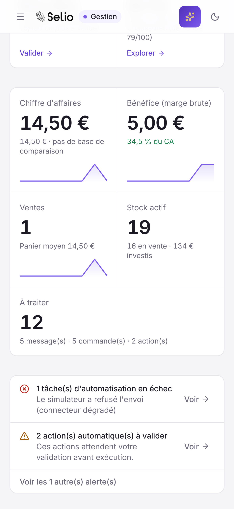 | 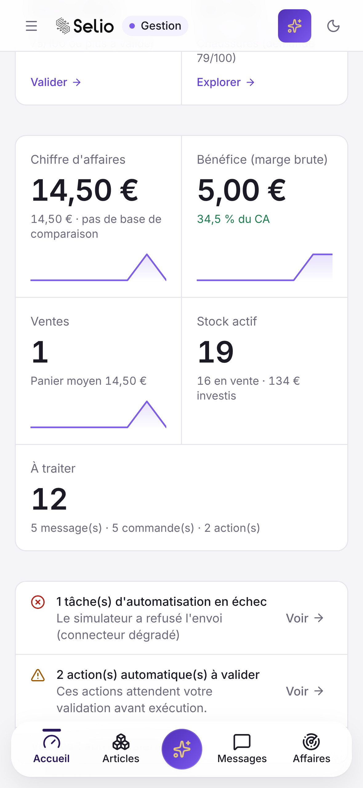 |
| iPhone 15 (émulé dans Chromium) | clair | Radar | 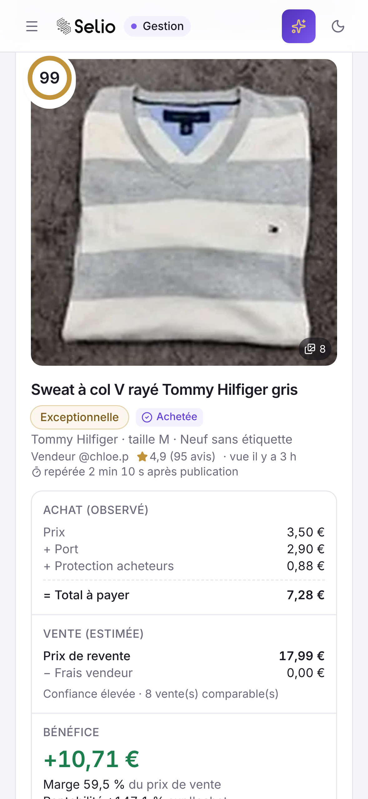 | 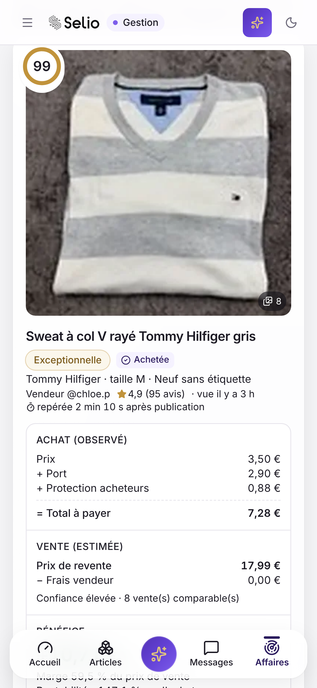 |
| iPhone 15 (émulé dans Chromium) | sombre | Vue d'ensemble | 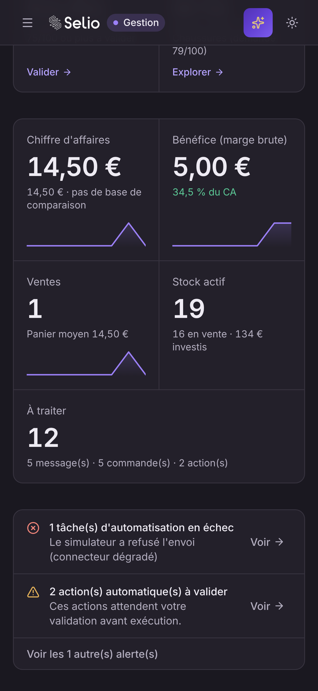 | 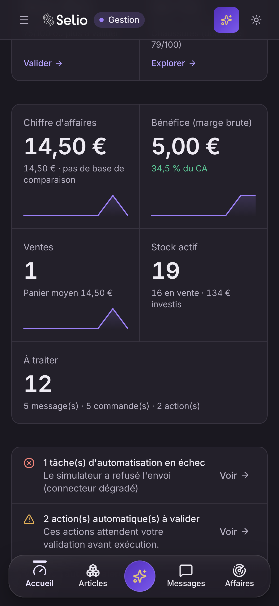 |
| iPhone 15 (émulé dans Chromium) | sombre | Radar | 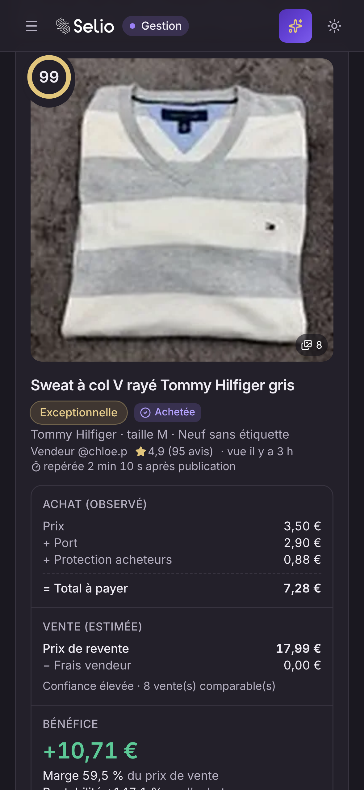 | 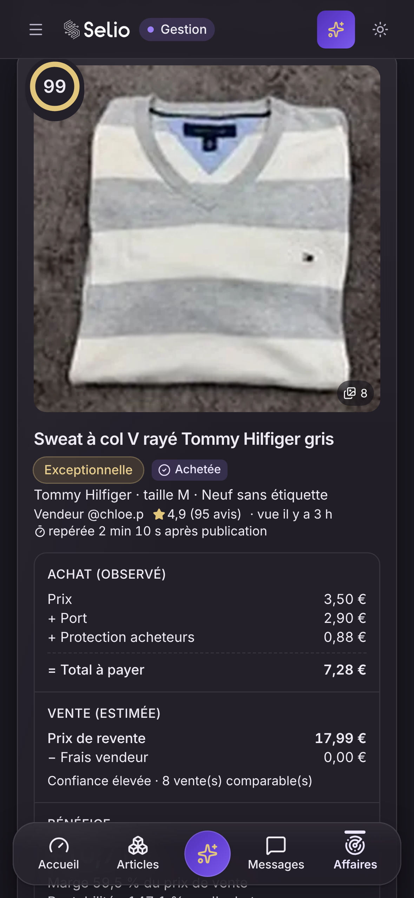 |
| Android 412 × 915 (émulé dans Chromium) | clair | Vue d'ensemble | 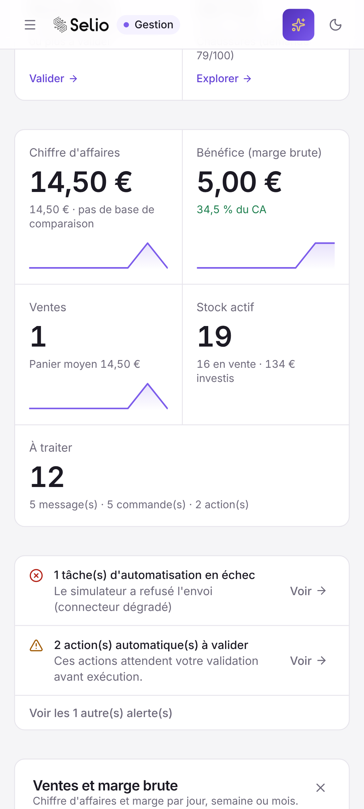 | 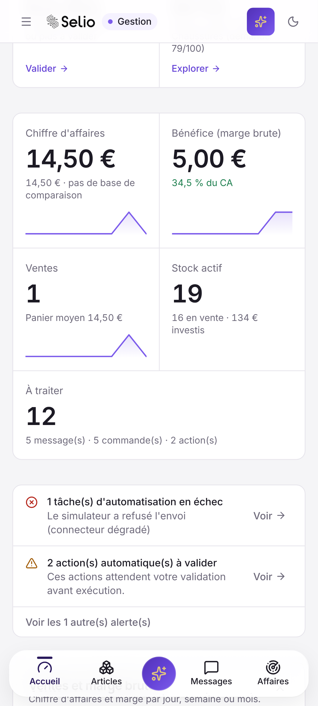 |
| Android 412 × 915 (émulé dans Chromium) | clair | Radar | 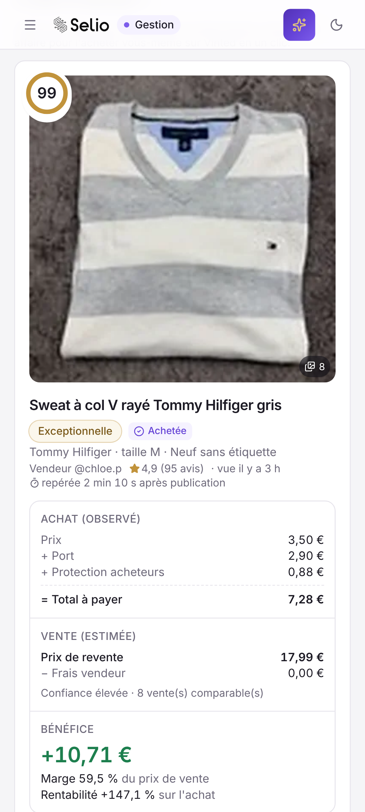 | 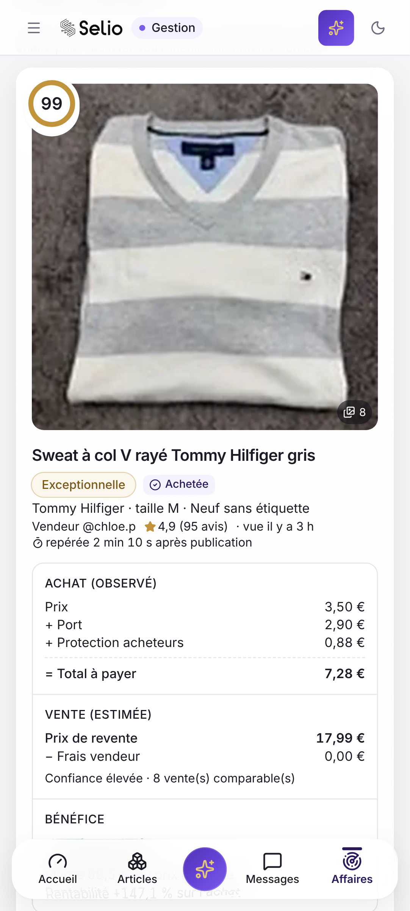 |
| Android 412 × 915 (émulé dans Chromium) | sombre | Vue d'ensemble | 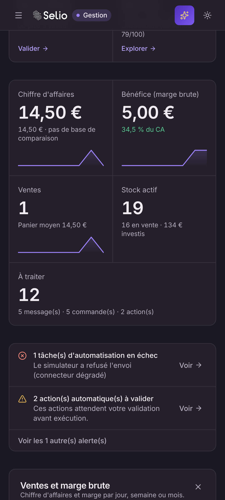 | 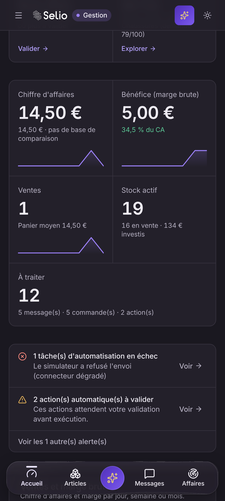 |
| Android 412 × 915 (émulé dans Chromium) | sombre | Radar | 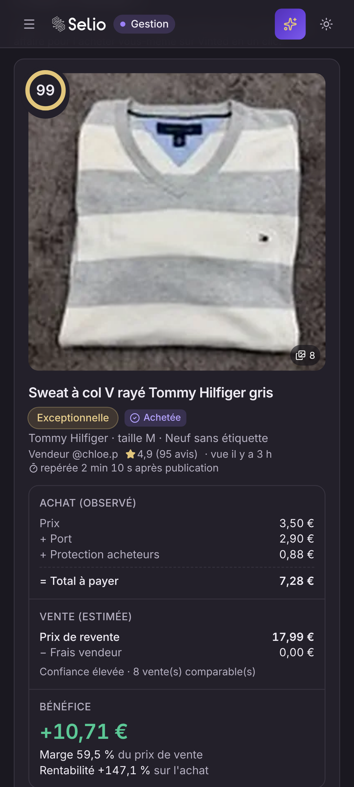 | 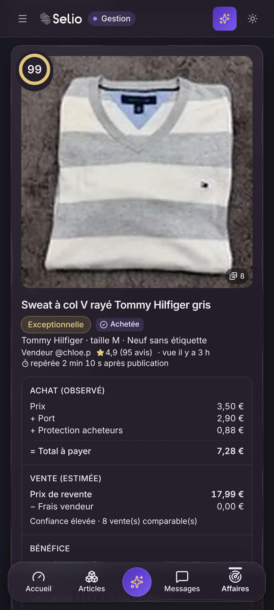 |

## Avis provisoire

On garde l'essai, limité au dock mobile et à la carte d'alerte du Radar, désactivé par défaut. On ne l'étend pas encore : le verre complet multiplie par 4,1 le temps de rendu d'une image par rapport au même dock opaque (jusqu'à 16 % du budget à 60 Hz, en rendu logiciel sur serveur) ; le flou et le liseré seuls coûtent au plus 2,3 % de plus que le même dock opaque ; c'est l'animation du reflet (repeinte à chaque image) et, sur Android, la réfraction qui multiplie(nt) le coût par 4,15. Aucune image lente de plus à 60 Hz ici. Piste si le coût gêne sur un vrai téléphone : figer le reflet (comme avec « réduire les animations ») plutôt que retirer le flou. À confirmer au doigt sur un iPhone (Safari) et un Android d'entrée de gamme avant toute extension.

Ce chiffre ne remplace pas un essai au doigt sur un iPhone (Safari) et un Android d'entrée de gamme : c'est là que le verre (reflet animé, flou) coûte le plus.
